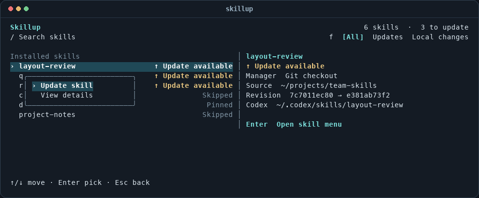

# skillup

[](https://github.com/M1chlCZ/skill-updater/releases)
[](go.mod)
[](LICENSE)

Run `skillup` to see which AI agent skills you have, where they live, and
which ones have updates. Skillup is written in Go and checks the source with Git.



## Install

[Homebrew](https://github.com/M1chlCZ/homebrew-tap) puts `skillup` on your PATH.

```sh
brew install m1chlcz/tap/skillup
skillup
```

You can also build it with Go 1.25 or newer. Keep Git on your PATH.

```sh
go install github.com/M1chlCZ/skill-updater/cmd/skillup@v0.6.2
skillup
```

Go puts the binary in `GOBIN` or `$(go env GOPATH)/bin` by default. Add
that directory to your PATH if your shell can't find `skillup`.
The terminal interface was tested on macOS. The same Go and Git commands
work on Linux, including in WSL.

## Using skillup

| Command | What happens |
| --- | --- |
| `skillup` | Opens the dashboard, with available updates at the top. |
| `skillup --check` | Prints the installed skills and their status. Redirecting the output gives you the same text view. |
| `skillup --apply` | Applies all eligible updates and prints what changed. |
| `skillup --check --skill demo` | Checks the installation named exactly `demo`. |
| `skillup --apply --skill demo` | Applies an eligible update to that installation. |

Move with **↑/↓** and press **Enter** to open a small menu beside the selected row. Choose **View details** for the full installation record. When an update is available, **Enter** opens the confirmation.
Press **Enter** again to apply a single-folder update. Press **y** to confirm
an update to a Git checkout or all eligible skills. **Esc** goes back.

Press **/** to search by skill name, location label, or install path. Press
**Enter** to keep the search and return to the list. **f** cycles through All,
Updates, and Local changes. **Esc** clears the search, then the status filter.

**Ctrl+P** opens a searchable command palette. **?** shows keyboard shortcuts.
Use **u** to review the selected update, **a** to review all eligible updates,
**r** to check again, or **q** to quit. The all-skills action includes rows
hidden by search or filters.

The skill panel shows the manager, skip reason, source, revision, and install
paths. Scroll with **↑/↓**, **Page Up**, or **Page Down**. Wide terminals also
show a preview next to the list. Text output shows the manager as well.

The dashboard lists local skills while it checks their sources. You can
browse, search, or quit during the check. The status filter keeps rows
visible while their status is pending. If a source fails, its error appears
alongside the other results and the list stays available.

If two agents link to the same skill folder, you'll see one row with both
paths. If a name matches multiple installations, the text command lists
the paths. Rerun it with `--path /path/from/the/list` to pick one.

A Git checkout can supply several skills, and they all share its revision.
A selected update in the dashboard shows the whole checkout and its
installed skills, including any hidden by filters. Use **↑/↓** to scroll
the confirmation as needed. A targeted text update stops if the checkout
is shared or incoming changes touch files outside the selected skill.
Targeted updates also stop when the selected folder or checkout
overlaps a separate installation outside its scope.

## Which skills get updated?

Skillup looks in `~/.agents/skills`, `$CODEX_HOME/skills` (default
`~/.codex/skills`), and `$CLAUDE_CONFIG_DIR/skills` (default
`~/.claude/skills`). It supports these installations.

- Skills you link yourself. On an untracked skill, press **Enter → Link GitHub source**, paste a GitHub repository URL or `owner/repository`, then press **Enter**. Skillup checks all untracked installations for unique matching folder names and verifies their files against the repository, including older revisions. Linking saves verified matches in `~/.skillup/sources.json`. Updates are a separate action.
- Global GitHub installs from Vercel's `skills` CLI. Skillup reads the
  version 3 lock at `~/.agents/.skill-lock.json` or
  `$XDG_STATE_HOME/skills/.skill-lock.json`. It checks the installed files
  against the recorded Git tree and compares the whole skill with the
  current source branch. It skips pins, separate agent copies, symlinked
  canonical targets, Git trees it can't reconstruct, and trees with
  symlinks or submodules.
- A skill or a `skills/` folder linked to a Git checkout. The checkout
  needs a clean working tree and a branch that tracks a remote branch.
  Skillup checks that Git can fast-forward before it moves the branch.
  A preview shows when the remote revision differs, even if that revision
  hasn't been fetched yet.

Skillup reads GitHub CLI tracking metadata from the installed `SKILL.md`
and Skild tracking metadata from `.skild/install.json`. Use `gh skill update`
or `skild update` for those installs. The shared version 3 lock is labeled
`Skills lock` because both GitHub CLI and Vercel can write it. If its record
matches a separate GitHub CLI installation with the same name, Skillup
leaves the ambiguous shared install alone. It also skips linked checkouts
that contain skills managed by GitHub CLI or Skild.

Local edits stay in place. Updates also skip manually copied skills,
plugin caches, project installs and installs managed by other tools.
Check the status for the reason. Git and filesystem errors give the
text command a nonzero exit status.

### What happens on disk

Checks fetch upstream data into temporary directories. During an update,
skillup prepares the new files, then swaps in a folder accessible only to
your user. It keeps the old folder until it saves the lockfile. If saving
fails, skillup restores the old folder.

Run one installer at a time. After a forced interruption, an existing
`~/.skillup.lock` directory blocks another apply. First check that nothing
is still running. Look in any `~/.agents/.skillup-*` staging directory
for an `old` backup before you remove the lock directory and run another check.

## Installer compatibility research

A skill can carry optional metadata. Each installer decides where to track
the source and version. [Agent Skills specification](https://agentskills.io/specification)

| Installer | Where it tracks the source | How it updates |
| --- | --- | --- |
| Vercel `npx skills` | A user lock with the source and Git tree, plus a separate project lock | `skills update -g` reinstalls changed global skills. [Global lock](https://github.com/vercel-labs/skills/blob/v1.9.0/src/skill-lock.ts) · [Commands](https://github.com/vercel-labs/skills/blob/main/docs/commands.md#skills-update) |
| GitHub CLI `gh skill` | The shared version 3 lock and GitHub fields in the installed `SKILL.md` | `gh skill update --dry-run` previews changes. GitHub CLI handles release selection and the local frontmatter. [Frontmatter](https://github.com/cli/cli/blob/v2.105.0/internal/skills/frontmatter/frontmatter.go) · [Update source](https://github.com/cli/cli/blob/v2.105.0/pkg/cmd/skills/update/update.go) |
| Swift `skill` | `agents.json` and `agents.resolved`, with the source and a revision or digest | `skill update --scope user` previews changes. Add `--apply` to update using its own records. [Lock format](https://github.com/agents-tools/core/blob/65df60ef97ff6d347b6944372a1b75de919313fe/Documentation/Architecture/State.md#lock) · [Commands](https://github.com/skill-cli/cli/blob/a59c92c892219280ff6db6d27ab56bb796fbff79/Documentation/Reference/CLI.md#update-restore-remove-and-initialize) |
| Skild | Each install has a `.skild/install.json` file, and Skild also keeps a lock | `skild update` reinstalls from the recorded source. [Locations](https://github.com/Peiiii/skild/blob/42d63166c75842856337ff9624032959f0112edd/packages/core/src/paths.ts#L24-L87) · [Update source](https://github.com/Peiiii/skild/blob/42d63166c75842856337ff9624032959f0112edd/packages/core/src/lifecycle.ts#L694-L720) |
| Codex `$skill-installer` | It copies the folder into the Codex home without an updater manifest | It refuses to overwrite an existing destination. [Installer](https://github.com/openai/skills/blob/main/skills/.system/skill-installer/SKILL.md) |

## Development

The dashboard uses Lip Gloss for its layout and
Bubbles for search input and the loading animation during checks and updates.

```sh
go test ./...
go vet ./...
go run ./cmd/skillup
go run ./cmd/skillup --check
```

Licensed under [MIT](LICENSE).
